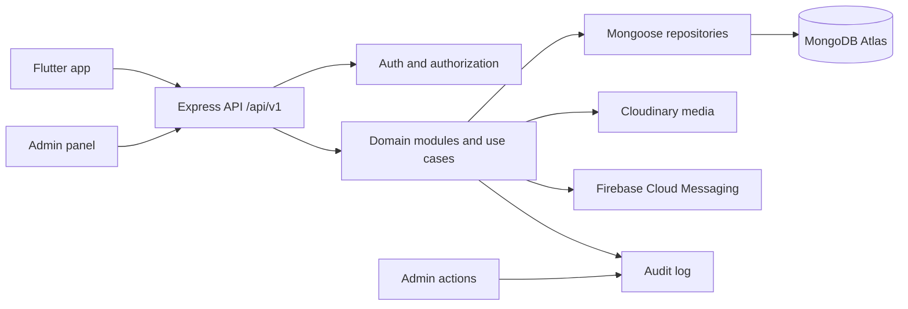

# Dr. Hair data architecture and API design

**Status: design proposal, based on the current Flutter routes/screens and the admin panel.** This document inventories the API surface to build; it does not claim the endpoints are implemented. Keep the existing legacy routes while the clients are migrated to the versioned REST API.

## Screens reviewed

### Mobile app

- Sign in / OTP, profile and profile photo
- Home: featured products, appointment prompt, reviews, videos, tips, FAQ and clinic information
- Hair assessment, scalp photos, assessment result and treatment details
- Care routine, progress photo check-ins, reminders, diet plan and order tracking
- Clinic appointment request, reschedule and cancellation
- Product catalog, product details, cart, address selection, checkout and order tracking
- Reviews, video stories, notifications, contact and policy pages

The mobile app currently keeps OTP, profile, assessment, cart, care and appointment behavior in local/demo state. Reminder alarms are local notifications today. The API should become the source of truth for account, clinical, appointment and order records; local reminders can remain device-local for the first release.

### Admin panel

- Overview/dashboard
- Patients and clinical profiles, assessments, progress, care plans and documents
- Hair tests and reports with draft → review → approve → share states
- Clinic appointment calendar, OPD statuses and clinic holidays
- Product catalog, stock, orders, coupons and referrals
- App content: videos, patient stories, reviews and home banners/placements
- Push notification drafts, audiences and scheduling
- App version/update policies and feature availability
- Admin accounts, role templates, permission overrides and audit history

The admin panel currently uses demo sign-in and browser session state. The backend must enforce every permission; hiding a tab in the browser is not authorization.

## Recommended architecture

Keep one Express modular monolith. Each module owns its routes/controllers, use cases, validation and Mongoose repositories. Render hosts the API; MongoDB Atlas stores records; Cloudinary stores media; Firebase Cloud Messaging delivers push messages. Do not add Redis until traffic or a measured cache/queue need justifies it.

### Server modules

1. `auth`: OTP challenge, session/refresh token, sign-in and sign-out.
2. `users`: patient profile, contact details, addresses and account status.
3. `media`: signed Cloudinary upload and access-controlled delivery.
4. `assessments`: patient questionnaire drafts, submissions and scalp photos.
5. `clinical`: uploaded test files, doctor reports, approvals, sharing and documents.
6. `care`: care plans, treatments, progress check-ins, routine and diet completion.
7. `appointments`: patient requests and the clinic schedule.
8. `catalog`: products, supply-plan variants and inventory.
9. `orders`: server-priced checkout, payment state, fulfilment, returns and refunds.
10. `reviews` and `content`: reviews, videos, banners and home-screen content.
11. `notifications`: device tokens, app inbox, FCM campaigns and delivery records.
12. `admin`: dashboard queries, staff roles/permissions and audit log.
13. `app-config`: feature flags and Android/iOS release policies.

Use one API prefix, `/api/v1`. Keep old Flutter-compatible route names as temporary aliases. Use MongoDB ObjectIds internally; expose stable human-readable identifiers such as `patientNumber`, `assessmentRef` and `orderNumber` where the UI needs them. Use UTC ISO-8601 timestamps and integer minor currency units (`amountPaise`, `currency: "INR"`) for commerce.

## MongoDB collections

| Collection | Main contents and screen use |
|---|---|
| `users` | Patient identity, normalized email/phone, profile, account status, patient number and avatar asset reference. |
| `otp_challenges` | Hashed OTP, verified identifier, expiry, attempt count and resend state. TTL index on expiry. |
| `admin_accounts` | Admin identity, active/suspended/invited status, role template and permission overrides. Separate from patient profile data. |
| `sessions` | Hashed refresh token, admin/user reference, device, expiry and revocation time; supports sign-out and staff suspension. |
| `hair_assessments` | Questionnaire answers, owner, photo asset references, draft/submitted/review status and timestamps. |
| `clinical_tests` | Admin-uploaded result files, patient/assessment reference, test metadata, uploader and review state. |
| `clinical_reports` | Clinician-authored diagnosis/summary, stage, metrics, attached files, approver, approval and patient-sharing timestamps. |
| `patient_documents` | Lab results, prescriptions, consent and other files; category, visibility, access and uploader metadata. |
| `care_plans` | Active/completed treatment plan, clinician, diagnosis, products/doses, instructions, routine steps, diet plan and next review. |
| `progress_checkins` | Patient rating, scalp region, shedding, notes, photo references and clinician review/note. |
| `appointments` | Patient, requested time, visit type, reason, source, clinician, room/token and status lifecycle. |
| `clinic_settings` | Available slots, working hours and holidays used by appointment booking/admin calendar. |
| `products` | Product page content, images, ingredients, benefits, usage, claims and embedded supply-plan variants/SKUs. |
| `inventory_movements` | Append-only stock changes with product/variant, quantity delta, reason and admin actor. |
| `addresses` | Patient-owned delivery addresses and default selection. |
| `coupons`, `referral_codes`, `referral_redemptions` | Promotions, limits, validity, referral ownership and redemption ledger. |
| `orders` | Server-calculated totals, immutable product/address snapshots, payment and fulfilment state, courier/tracking, cancellation/return/refund data. |
| `payment_transactions` | Payment-provider references, webhook state and refunds. Add only after a payment provider is chosen. |
| `reviews` | Patient feedback, rating, optional treatment reference, moderation state and consent to publish. |
| `videos` | Cloudinary or YouTube provider, title/caption/category/treatment tag, thumbnail, publication state and creator. |
| `video_comments`, `video_interactions` | Comments, likes and saved state keyed by user/video. Store counters as derived/cached fields, not the only record. |
| `home_banners`, `app_content` | Home hero/cards, educational tips, FAQ/certification entries, destinations, schedule and draft/published state. |
| `device_tokens` | FCM token, user, platform, last-seen and notification preferences. |
| `notification_campaigns`, `notification_deliveries`, `user_notifications` | Admin drafts/schedules/audiences, per-device send result and patient inbox/read state. |
| `feature_flags`, `app_release_policies` | Feature availability and Android/iOS latest/minimum version/build, store URL and update behavior. |
| `admin_audit_logs` | Admin actor, action, target, timestamp and redacted before/after summary. Append-only. |

The Atlas cluster has no live app data yet. Before first production records, split the current generic `hair_tests` concept into assessment, clinical test and report records. Keep the old endpoint path as an alias. Embed small bounded values such as questionnaire answers, order line snapshots and care-plan steps; keep growing records such as comments, audit entries, notifications and inventory history in their own collections.

### Useful indexes

- Unique sparse indexes on normalized user email and phone; unique `patientNumber`, `assessmentRef`, `orderNumber`, SKU and coupon code.
- `{ patientId, createdAt: -1 }` on assessments, reports, check-ins and orders.
- `{ status, createdAt: -1 }` on admin queues, reviews and clinical reports.
- `{ startsAt, status }` on appointments; `{ status, category, sortOrder }` on products/content.
- Unique device token; `{ userId, createdAt: -1 }` on notification inbox.
- TTL index on expired OTP challenges and short-lived upload/session artifacts.

## API conventions

- Patient-owned endpoints derive `patientId` from the verified bearer token. Never accept a client-supplied patient ID to select another patient's record.
- Admin endpoints require a server-checked permission such as `assessments.review`, `reports.share`, `orders.manage` or `content.publish`, followed by object-level checks.
- List endpoints use `page`, `limit`, filters and a consistent `meta` block. Return stable public IDs; do not expose MongoDB internals unnecessarily.
- Errors use a stable code/message/field-errors shape. All admin mutations, report sharing, stock changes, refunds and permission changes write an audit event.
- The server calculates product price, discount, tax/shipping and payable total. The client submits product/variant IDs, quantities and coupon code only.
- Uploads use short-lived server-signed Cloudinary parameters; persist asset IDs and metadata, not file bytes or Render local paths.

## Mobile API inventory

### Auth, home and profile

| Screen | APIs |
|---|---|
| Sign in / OTP | `POST /auth/send_login_otp`, `POST /auth/verify_login_otp` (already present as the current contract); add `POST /auth/refresh`, `POST /auth/logout`. |
| Profile | `GET /me`, `PATCH /me`, `POST /me/avatar/upload-signature`, `POST /me/avatar/complete`. Existing `/users/*` profile aliases remain during migration. |
| Home | `GET /app/home` returns selected banners, featured products, public reviews, videos, tips and FAQ; detailed resources remain independently queryable. |
| Contact/clinic info | `GET /app/clinic-info` only if this content must change without an app release; otherwise keep static pages in the app. |

### Assessment and care

| Screen | APIs |
|---|---|
| Hair assessment | `POST /hair-assessments` create draft; `PATCH /hair-assessments/{id}` save answers; `POST /hair-assessments/{id}/submit`; `GET /hair-assessments?mine=true`; `GET /hair-assessments/{id}`. Current submit/history endpoints exist as `/hair-tests/*` aliases. |
| Scalp photos | `POST /media/uploads/signature` and `POST /media/uploads/complete` for each image; assessment submit references completed asset IDs. |
| Result/treatment detail | `GET /me/clinical-reports`, `GET /clinical-reports/{id}`, `GET /me/care-plan`, `GET /me/care-plan/history`. Existing treatment-history API is present, but full report approval/sharing is not. |
| Progress | `GET /me/progress-checkins`, `POST /me/progress-checkins`, `DELETE /me/progress-checkins/{id}`. Upload images via signed media flow. |
| Routine | `GET /me/care-plan` supplies assigned tasks; `GET /me/routine-completions?date=...`; `PUT /me/routine-completions/{taskId}` toggles today's completion. |
| Diet plan | `GET /me/diet-plan`, `PUT /me/diet-checkins/{mealId}`. Keep nutrition templates in the assigned care plan. |
| Reminders | `GET/POST/PATCH/DELETE /me/reminders` only if settings should sync across devices. Local notification scheduling remains on the phone; remote campaigns are a separate admin feature. |

### Clinic and community

| Screen | APIs |
|---|---|
| Appointment booking | `GET /appointment-slots?from=...&to=...`, `GET /me/appointments`, `POST /me/appointments`, `PATCH /me/appointments/{id}/reschedule`, `POST /me/appointments/{id}/cancel`. |
| Reviews | `GET /reviews?status=published`, `POST /reviews`. New reviews enter a moderation queue. Current public read/create routes exist. |
| Videos | `GET /videos`, `GET /videos/{id}`, `PUT/DELETE /videos/{id}/like`, `PUT/DELETE /videos/{id}/saved`, `GET/POST /videos/{id}/comments`. Current public video listing exists; interactions are demo-only. |
| Notifications | `GET /me/notifications`, `PATCH /me/notifications/{id}/read`, `POST/DELETE /notifications/device-tokens`. Device-token API exists; inbox/read APIs do not. |

### Shop and orders

| Screen | APIs |
|---|---|
| Product catalog/details | `GET /products`, `GET /products/{id}`, optional `GET /products/{id}/related`. |
| Delivery addresses | `GET/POST /me/addresses`, `PATCH/DELETE /me/addresses/{id}`, `PATCH /me/addresses/{id}/default`. |
| Cart/checkout | Cart can stay local initially. `POST /coupons/validate`, then `POST /orders` with variant IDs, quantity, address ID and idempotency key. The API recalculates all amounts. |
| Order history/tracking | `GET /me/orders`, `GET /me/orders/{id}`, `POST /me/orders/{id}/cancel`, `POST /me/orders/{id}/return`. Payment gateway, refunds, delivery provider and return policy are decisions still needed before a real checkout. |

## Admin API inventory

| Admin screen | APIs to build |
|---|---|
| Admin sign-in | `POST /admin/auth/otp`, `POST /admin/auth/verify`, `POST /admin/auth/refresh`, `POST /admin/auth/logout`, `GET /admin/me`. Replace the panel's demo “any password” sign-in. |
| Overview | `GET /admin/dashboard/summary`, `GET /admin/dashboard/activity`; server computes real counts/revenue/queues under the caller's permissions. |
| Patients & assessments | `GET /admin/patients?search=&status=&page=`, `GET /admin/patients/{id}`, `GET /admin/patients/{id}/assessments`, `GET /admin/assessments/{id}`. Limited lookup and clinical chart access use separate permissions. |
| Clinical records/documents | `GET/POST /admin/patients/{id}/documents`, `GET /admin/documents/{id}/download-url`, `PATCH /admin/documents/{id}`; role-checked upload, private visibility and sharing. |
| Hair tests/reports | `GET /admin/clinical-tests`, `POST /admin/clinical-tests`, `PATCH /admin/clinical-tests/{id}/status`; `POST /admin/reports`, `PATCH /admin/reports/{id}`, `POST /admin/reports/{id}/approve`, `POST /admin/reports/{id}/share`. The existing admin currently only lists assessments and creates treatment-plan entries. |
| Care plans/progress | `GET/POST /admin/patients/{id}/care-plans`, `PATCH /admin/care-plans/{id}`, `GET /admin/patients/{id}/progress-checkins`, `POST /admin/progress-checkins/{id}/review`. |
| Appointments | `GET/POST /admin/appointments`, `PATCH /admin/appointments/{id}`, `GET/PATCH /admin/clinic-settings`, `POST/DELETE /admin/clinic-holidays/{date}`. |
| Products/inventory | `GET/POST /admin/products`, `GET/PATCH/DELETE /admin/products/{id}`, `POST /admin/products/{id}/inventory-movements`, `GET /admin/products/{id}/inventory-movements`. |
| Orders | `GET /admin/orders`, `GET /admin/orders/{id}`, `PATCH /admin/orders/{id}/fulfilment`, `POST /admin/orders/{id}/refund`, `POST /admin/orders/{id}/returns/resolve`, `GET /admin/commerce/summary`, `GET /admin/commerce/export`. Payment/refund actions require a selected gateway. |
| Coupons/referrals | CRUD `/admin/coupons`, `/admin/referral-codes`; `GET /admin/referrals/summary`. |
| Content & media | `GET/POST/PATCH /admin/videos`, Cloudinary upload-signature/finalize, YouTube URL add, publish/hide; CRUD `/admin/banners` and `/admin/home-content`. Existing basic video draft/publish and review moderation APIs exist. |
| Notifications | `GET/POST /admin/notification-campaigns`, `GET /admin/notification-campaigns/{id}`, `POST /admin/notification-campaigns/{id}/send`, `POST .../schedule`, `POST .../cancel`, `GET .../{id}/deliveries`, `POST /admin/notifications/send-to-user`. Current backend supports send-to-one-user only. Reliable scheduled sends need an always-running scheduler/worker; do not rely on a sleeping free web service. |
| App updates/features | `GET/PATCH /admin/app-release-policies/{platform}`, `GET/PATCH /admin/feature-flags`. |
| Admin team/audit | `GET/POST /admin/admin-users`, `GET/PATCH /admin/admin-users/{id}`, `POST .../{id}/suspend`, `POST .../{id}/reactivate`, `GET /admin/permissions`, `GET /admin/audit-logs`. |

Current implemented backend coverage and deployment blockers are tracked in [`API_ROADMAP.md`](API_ROADMAP.md). In short: auth/profile, assessment submission/history, treatment history, reviews, public videos, FCM token registration, and an initial admin set exist; the rest of this inventory is new work.

## Media privacy and external decisions

- Public product images, published banners and public educational videos can use normal Cloudinary delivery.
- Scalp photos, patient reports and private documents contain personal/clinical data. Upload these with Cloudinary `authenticated` access, and generate a short-lived signed delivery URL only after the API authorizes that patient/admin. Cloudinary documents that normal `upload` delivery is public by default and that `authenticated` protects originals and transformed versions. [Cloudinary access control](https://cloudinary.com/documentation/control_access_to_media) · [Cloudinary upload parameters](https://cloudinary.com/documentation/upload_parameters)
- Do not put private medical details in FCM push text; send a generic alert and let the authenticated app fetch the report.
- Real checkout waits for the payment gateway, shipping/courier, COD/online policy, tax and refund rules.
- OTP provider and admin sign-in policy must be selected before public authentication.
- Render Free sleeps when idle; it is suitable for API development but not for guaranteed scheduled campaigns. Use an always-on service/worker or an external scheduler when scheduled push is required.

## Recommended build order

1. Agree on the admin identity/permission model, OTP provider and media privacy policy; establish API response/error conventions.
2. Finish auth, `/me`, patient profiles, assessment drafts/submission and Cloudinary asset ownership.
3. Add clinical tests/reports, doctor approval/sharing, care plans, progress check-ins and patient document access.
4. Add appointments and availability/holiday management.
5. Connect read-only home content, products, reviews and videos; then implement admin content editing/moderation.
6. Add server-backed notification inbox/device registration; add campaigns/scheduling only with a reliable scheduler.
7. Implement products/inventory, addresses, coupons and orders after payment/shipping/refund decisions are made.
8. Add admin team roles, server-side per-action authorization, feature/release settings, dashboard aggregates and audit/export APIs.

The current OpenAPI file should be expanded as each phase is implemented; keep this blueprint as the screen-to-resource checklist.
